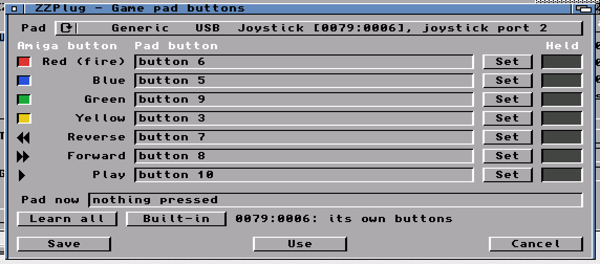

#  ZZPlug

A small, zero-configuration USB stack for the **MNT ZZ9000** in an Amiga
(AmigaOS 3.1 or newer). Put a USB 2.0 hub on the ZZ9000's USB port, plug
your devices into the hub, and they work: there is nothing to set up first.
Mice, keyboards and game pads need the hub; USB sticks can also go straight
into the ZZ9000's port.

ZZPlug talks to the ZZ9000 firmware's USB proxy directly and does the USB
host work itself: port resets, enumeration, hubs, then a driver for each kind
of device. It says in plain words what it found, and what is wrong when
something doesn't work.

## ZZPlugPrefs


*ZZPlugPrefs on an A4000: a hub with a game pad and a mouse behind it; the pad
is selected and its details are on the right.*


*Its icon: a USB plug under a port. Clicked, the plug goes home and a green
light comes on.*

## What it supports

| Device | What you get |
|---|---|
| USB 2.0 hubs | Everything plugged into them, found and lost as you plug and unplug. Low- and full-speed devices behind a high-speed hub work through its transaction translator. |
| Mice | The pointer and buttons through input.device; the wheel (and a tilt wheel) as NewMouse wheel events, side buttons as NewMouse's 4th and 5th button. ZZPlug reads each mouse's own report layout; a mouse that only sends simple boot reports still gets its wheel and side buttons when it puts them there. |
| Keyboards (boot protocol) | Keys, qualifiers and repeat, through input.device. Caps Lock and its light work like the Amiga's; the Num Lock light stays on (the Amiga's keypad always gives numbers). On a keyboard without a right Windows key, the Menu key is the right Amiga key. |
| Game pads and joysticks (HID) | Joystick port 2 for programs that use lowlevel.library (`ReadJoyPort`), as a CD32 pad: directions plus red, blue, green, yellow, reverse, forward and play. |
| USB sticks (mass storage) | Mounted as `USB0:`, `USB1:`, ... through `zzusbdisk.device`. FAT12/16/32 sticks with or without a partition table; CrossDOS (comes with AmigaOS) or fat95. The same stick keeps its unit when it comes back. |

Anything else is listed by `ZZPlug LIST` and in ZZPlugPrefs as found, with no
driver for it yet.

## Needs

- An MNT ZZ9000 (Zorro II or III) with **firmware 2.8 or newer**, which has
  the USB proxy protocol version 2.
- AmigaOS 3.1 or newer and a 68020 or better.
- lowlevel.library for game pads; CrossDOS (`L:CrossDOSFileSystem`) or fat95
  (`L:fat95`) for USB sticks.
- Mice, keyboards and game pads need a USB 2.0 hub between them and the
  ZZ9000: they are low-speed devices, and the ZZ9000's own port doesn't talk
  to them directly. USB sticks work with or without the hub.

ZZPlug can't share the port with another USB stack. If one is running on the
ZZ9000's port, ZZPlug says so and does not start.

## Installing

Download `ZZPlug-<version>.lha` (or the `.adf` install floppy) from the
[releases](https://github.com/lainejones/ZZPlug/releases), unpack it and
double-click **Install_ZZPlug**. It copies ZZPlug to `C:` and ZZPlugPrefs to
`SYS:Prefs`, puts the README and the test tools in a ZZPlug drawer, starts
ZZPlug at boot from `S:User-Startup` and starts it now. Run it again to
update or to remove ZZPlug.

By hand instead:

1. Copy `ZZPlug` to `C:` and `ZZPlugPrefs` (with its icon) to `SYS:Prefs`.
2. Add this to `S:User-Startup`:

   ```
   ;BEGIN ZZPlug
   Run >NIL: C:ZZPlug START QUIET
   ;END ZZPlug
   ```

3. Reboot.

## Using it

```
ZZPlug                   what is plugged in (from the running ZZPlug)
ZZPlug LIST VERBOSE      the same with addresses, speeds, interfaces and endpoints
ZZPlug START [QUIET]     run it (from S:User-Startup, with Run >NIL:)
ZZPlug STOP              stop it (refused while a USB stick is mounted)
ZZPlug DIAG [ALL]        the ZZ9000 firmware's USB diagnostic page, read only
ZZPlug DUMP [SECS=n]     record a device ZZPlug does not know yet (see below)
ZZPlug RESET             one root-port reset and its diagnostic record (ZZPlug stopped)
```

**ZZPlugPrefs** shows what is plugged in and what ZZPlug does with each
device, kept current while it is open; click one for its details. It also
starts and stops ZZPlug, chooses the filesystem for FAT sticks and shows the
game pad live. Save keeps the settings, Use keeps them until the next reboot.

**Buttons...** opens the game pad window: every pad plugged in, and which of
its buttons plays each Amiga button. Press **Set** on a row, then the pad's
button; **Learn all** goes through the seven in turn, **Built-in** goes back to
ZZPlug's own layout. A light shows each row while its button is held. Each
kind of pad keeps its own layout.



### Settings (ENV:, saved to ENVARC: by ZZPlugPrefs)

| Variable | Meaning |
|---|---|
| `ZZPlug.dostype` | The DosType FAT sticks mount with: `0x4D534400` CrossDOS (the default), `0x46415400` fat95. |
| `ZZPlug.padbuttons.VVVV-PPPP` | Which of the pad's buttons does what, for one kind of pad (its USB vendor and product ID, e.g. `ZZPlug.padbuttons.0079-0006`): the pad's button numbers for red, blue, green, yellow, reverse, forward, then the rest (`0` leaves one as it is). Read when a pad is plugged in; ZZPlugPrefs' Learn saves it for the pad that is plugged in. |
| `ZZPlug.padbuttons` | The same for every pad that has no setting of its own. |

## Known limits

- **A hub plugged in when the Amiga is switched on is not found until it is
  unplugged and plugged in again.** A warm reboot keeps it. This is in the
  ZZ9000 firmware's USB start-up, reported as
  [zz9000-firmware#194](https://github.com/BlitterStudio/zz9000-firmware/issues/194).
- Games that read the joystick hardware directly don't see a USB pad; programs
  that ask lowlevel.library do (system-friendly games, CD32 titles, emulators).
- Keyboards are driven in boot protocol: their extra keys (media, power) are
  not. The wheel only scrolls in programs that understand NewMouse wheel
  events (most current ones do).

## A device that doesn't work yet

ZZPlug can record what a device it doesn't know sends, so a driver can be
written for it without having one here. Plug the device in, open
ZZPlugPrefs and press **Record a device...** (or run `ZZPlug DUMP` in a
Shell). A window says what to do: press each button, move each stick or
wheel, one at a time, for 30 seconds. The recording is saved as
`RAM:ZZPlug-dump.txt`.

[Open a device report](https://github.com/lainejones/ZZPlug/issues/new?template=device-report.yml):
the form asks for the device, what you pressed in which order, and the file.

The file holds every device's descriptors (device, configuration and HID
report descriptors) and each report that changed while recording, from the
devices ZZPlug drives and from HID devices it doesn't. Recording changes
nothing: a mouse keeps working meanwhile.

```
ZZPlug DUMP [SECS=n] [TO=file]     record for n seconds (default 30) into file
```

## Test tools

- `JoyTest [PORT=n] [SECS=n]` prints what lowlevel.library reads from a
  joystick port as it changes.
- `KeyTest [SECS=n] [TO=file]` opens a window and records every key it gets:
  raw code, up or down, qualifiers and the character.

## Building

The Amiga programs are built with amiga-gcc (bebbo) in WSL; `build.ps1`
builds `out/ZZPlug`, `out/ZZPlugPrefs`, `out/JoyTest` and `out/KeyTest`.
`dist.sh` stages the release drawer in `dist/` (the committed icons in
`icons/`, the installer and package README from `dist-src/`);
`tools/mkadf.sh` makes the install floppy from it. The `.lha` is made on an
Amiga (`LhA -r a ZZPlug-<version>.lha ZZPlug ZZPlug.info`) so the files keep
their protection bits.
`test.ps1` builds and runs the host tests: the USB core, hubs, the HID and
mass-storage code and the game pad mapping against a simulated bus, on the PC.

## Licence

GPL-3.0-or-later. See [LICENSE](LICENSE).

## Credits

The USB proxy protocol is the ZZ9000 firmware's, documented in
`docs/usb-proxy-protocol.md` of
[BlitterStudio/zz9000-firmware](https://github.com/BlitterStudio/zz9000-firmware).
The ZZ9000 is by MNT Research.
