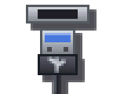
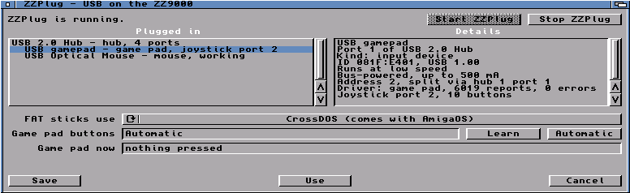
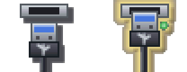

#  ZZPlug

A small, zero-configuration USB stack for the **MNT ZZ9000** in an Amiga
(AmigaOS 3.1 or newer). Plug a device into the ZZ9000's USB port, or into a
hub on it, and it works: there is nothing to set up first.

ZZPlug talks to the ZZ9000 firmware's USB proxy directly and does the USB
host work itself: port resets, enumeration, hubs, then a driver for each kind
of device. It says in plain words what it found, and what is wrong when
something doesn't work.

## ZZPlugPrefs



*ZZPlugPrefs on an A4000: a hub with a game pad and a mouse behind it; the pad
is selected and its details are on the right.*



*Its icon: a USB plug under a port. Clicked, the plug goes home and a green
light comes on.*

## What it supports

| Device | What you get |
|---|---|
| USB 2.0 hubs | Everything plugged into them, found and lost as you plug and unplug. Low- and full-speed devices behind a high-speed hub work through its transaction translator. |
| Mice (boot protocol) | The Amiga's pointer and buttons, through input.device. |
| Keyboards (boot protocol) | Keys, qualifiers and repeat, through input.device. Caps Lock and its light work like the Amiga's; the Num Lock light stays on (the Amiga's keypad always gives numbers). On a keyboard without a right Windows key, the Menu key is the right Amiga key. |
| Game pads and joysticks (HID) | Joystick port 2 for programs that use lowlevel.library (`ReadJoyPort`), as a CD32 pad: directions plus red, blue, green, yellow, reverse, forward and play. |
| USB sticks (mass storage) | Mounted as `USB0:`, `USB1:`, ... through `zzusbdisk.device`. FAT12/16/32 sticks with or without a partition table; CrossDOS (comes with AmigaOS) or fat95. The same stick keeps its unit when it comes back. |

Anything else is listed by `ZZPlug LIST` and in ZZPlugPrefs as found, with no
driver for it yet.

## Needs

- An MNT ZZ9000 (Zorro II or III) with **firmware 2.8 or newer**, which has
  the USB proxy protocol version 2.
- AmigaOS 3.1 or newer and a 68020 or better.
- lowlevel.library for game pads; CrossDOS (`L:CrossDOSFileSystem`) or fat95
  (`L:fat95`) for USB sticks.
- Low-speed devices (most mice and keyboards) need a USB 2.0 hub between them
  and the ZZ9000: the ZZ9000's own port doesn't talk to them directly.

ZZPlug can't share the port with another USB stack. If one is running on the
ZZ9000's port, ZZPlug says so and does not start.

## Installing

1. Copy `ZZPlug` to `C:` and `ZZPlugPrefs` (with its icon) to `SYS:Prefs`.
2. Add this to `S:User-Startup`:

   ```
   ;BEGIN ZZPlug
   Run >NIL: C:ZZPlug START QUIET
   ;END ZZPlug
   ```

3. Reboot.

## Using it

```
ZZPlug                   what is plugged in (from the running ZZPlug)
ZZPlug LIST VERBOSE      the same with addresses, speeds, interfaces and endpoints
ZZPlug START [QUIET]     run it (from S:User-Startup, with Run >NIL:)
ZZPlug STOP              stop it (refused while a USB stick is mounted)
ZZPlug DIAG [ALL]        the ZZ9000 firmware's USB diagnostic page, read only
ZZPlug RESET             one root-port reset and its diagnostic record (ZZPlug stopped)
```

**ZZPlugPrefs** shows what is plugged in and what ZZPlug does with each
device, kept current while it is open; click one for its details. It also
starts and stops ZZPlug, chooses the filesystem for FAT sticks, shows the game
pad live, and learns a pad's buttons: press Learn, then each button as it asks.
Save keeps the settings, Use keeps them until the next reboot.

### Settings (ENV:, saved to ENVARC: by ZZPlugPrefs)

| Variable | Meaning |
|---|---|
| `ZZPlug.dostype` | The DosType FAT sticks mount with: `0x4D534400` CrossDOS (the default), `0x46415400` fat95. |
| `ZZPlug.padbuttons` | Which of the pad's buttons does what, as the pad numbers them: red, blue, green, yellow, reverse, forward, then the rest (`0` leaves one as it is). Read when a pad is plugged in. |

## Known limits

- **A hub plugged in when the Amiga is switched on is not found until it is
  unplugged and plugged in again.** A warm reboot keeps it. This is in the
  ZZ9000 firmware's USB start-up, reported as
  [zz9000-firmware#194](https://github.com/BlitterStudio/zz9000-firmware/issues/194).
- Games that read the joystick hardware directly don't see a USB pad; programs
  that ask lowlevel.library do (system-friendly games, CD32 titles, emulators).
- Only boot-protocol mice and keyboards are driven: their extra keys (media,
  power) are not.

## Test tools

- `JoyTest [PORT=n] [SECS=n]` prints what lowlevel.library reads from a
  joystick port as it changes.
- `KeyTest [SECS=n] [TO=file]` opens a window and records every key it gets:
  raw code, up or down, qualifiers and the character.

## Building

The Amiga programs are built with amiga-gcc (bebbo) in WSL; `build.ps1`
builds `out/ZZPlug`, `out/ZZPlugPrefs`, `out/JoyTest` and `out/KeyTest`.
`test.ps1` builds and runs the host tests: the USB core, hubs, the HID and
mass-storage code and the game pad mapping against a simulated bus, on the PC.

## Licence

GPL-3.0-or-later. See [LICENSE](LICENSE).

## Credits

The USB proxy protocol is the ZZ9000 firmware's, documented in
`docs/usb-proxy-protocol.md` of
[BlitterStudio/zz9000-firmware](https://github.com/BlitterStudio/zz9000-firmware).
The ZZ9000 is by MNT Research.
